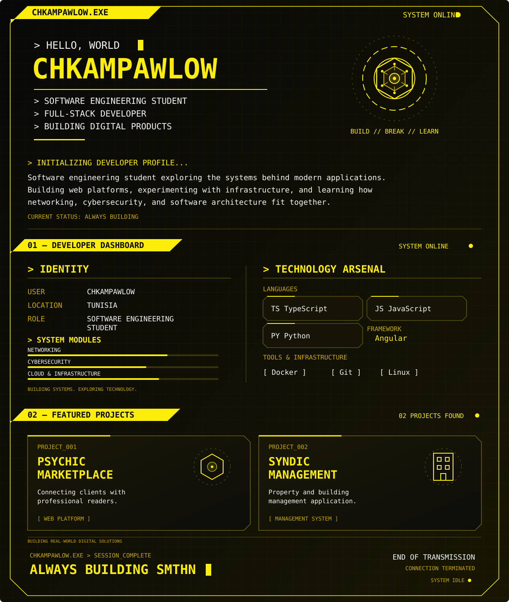

  <!-- One SVG keeps the profile sections continuous on GitHub.
       Rebuild after editing source banners: python3 scripts/build_profile.py -->
  

  <!-- PROJECT LINK -->
  

  <!-- GITHUB STATISTICS -->
  <h3>⚡ 03 — DEVELOPER ACTIVITY</h3>

  

  

  <!-- GALACTIC ARCADE -->
  <h3>🛸 BONUS LEVEL — GALACTIC ARCADE</h3>

  

  

    INSERT COIN — BUILD — BREAK — LEARN
  

  <!-- CONNECTIONS -->
  <h3>⚡ 04 — ESTABLISH CONNECTION</h3>

  

  

